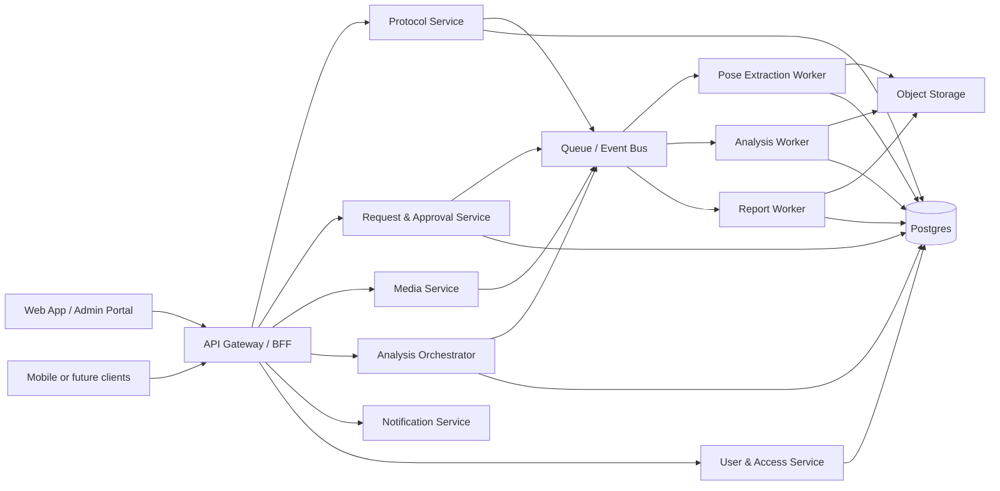

# Moove Production Architecture

## 1. Purpose

This document defines a production-ready architecture for the next version of Moove, based on the current product direction:

- physiotherapists create and manage custom protocols
- protocols can be requested, approved, and made visible to coaches, athletes, and caretakers
- superadmins manage workflow and approvals from a dashboard
- video upload triggers a two-stage backend pipeline:
  1. pose extraction
  2. protocol-specific analysis and report generation
- the system must support detailed logs, audit trails, error tracking, retries, role-based access, and future scaling

This design follows a microservices-oriented approach while keeping implementation practical for the current codebase.

---

## 2. Architecture Principles

### Core principles
- Domain-driven service boundaries
- Clear ownership of data by service
- Event-driven asynchronous processing for heavy analysis work
- Idempotent job execution for retries and recovery
- Structured logs and correlation IDs for every request and job
- Role-based access control from the start
- Backend-first implementation with frontend integration later
- Keep the existing demo experience intact while the new architecture runs in parallel

### Non-functional goals
- reliability
- traceability
- scalability
- observability
- security
- maintainability
- low operational friction

---

## 3. High-Level System View

The system is split into:

- frontend applications for different roles
- an API layer and gateway
- domain services for protocols, access, requests, media, analysis, reports, notifications
- event-driven background workers for pose extraction and analysis
- cloud storage and databases for persistence
- observability and monitoring tools

### Logical topology



---

## 4. Recommended Technology Stack

### Backend
- Python with FastAPI for new services
- Cloud Run for service hosting
- Cloud Pub/Sub for asynchronous messaging
- Cloud SQL for transactional relational data
- Cloud Storage for videos, pose intermediates, PDFs, reports
- Redis for short-lived caching and job coordination
- OpenTelemetry for tracing
- Structured JSON logging to Cloud Logging / Loki / ELK
- Sentry for error capture

### Frontend
- React with TypeScript
- Vite for build tooling
- TanStack Query for server state and caching
- Zustand or Redux Toolkit for shared client state
- Feature-based folder structure
- WebSocket or SSE for live status updates
- Role-aware routing and permission checks

### Data and storage
- PostgreSQL as the primary system of record
- Cloud Storage for binary artifacts
- Firestore as a read-optimized projection only during transition if needed

---

## 5. Backend Microservices Design

## 5.1 API Gateway / BFF

Purpose:
- unify frontend access to backend services
- authenticate requests
- route requests to correct internal services
- enforce rate limiting and request validation
- attach correlation IDs and user context

Responsibilities:
- authentication and authorization pass-through
- request logging
- aggregation for simple frontend needs
- frontend-specific response shaping

Recommended endpoints:
- POST /api/v1/protocols
- GET /api/v1/protocols
- POST /api/v1/protocol-requests
- GET /api/v1/protocol-requests
- POST /api/v1/analyses
- GET /api/v1/analyses/{id}
- GET /api/v1/reports/{id}
- GET /api/v1/reports/{id}/pdf

---

## 5.2 Identity and Access Service

Purpose:
- manage users, roles, permissions, and access rules

Core entities:
- user
- role
- permission
- organization or clinic
- access grant

Roles:
- superadmin
- physiotherapist
- coach
- athlete
- caretaker
- analyst or protocol editor

Responsibilities:
- user registration and profile management
- role assignment
- permission checks for protocol visibility and report access
- tenant or clinic scoping if applicable

Best practice:
- access decisions should be enforced in each service, not only at the gateway

---

## 5.3 Protocol Service

Purpose:
- manage custom protocols and their configuration

Core entities:
- protocol
- protocol_version
- protocol_visibility_rule
- protocol_access_grant

Protocol payload includes:
- protocol name
- description
- created_by
- owner_role
- visibility scope
- analysis configuration
- baseline metrics
- risk factors
- report template sections
- required views
- expected duration

Responsibilities:
- create, edit, version, publish, archive protocols
- expose visible protocols by role and scope
- store the protocol definition used by analysis workers
- support future protocol-to-baseline mapping

Important design note:
- the protocol should be treated as a first-class domain object, not just a UI form payload

---

## 5.4 Request and Approval Service

Purpose:
- manage protocol requests and approvals

Core entities:
- protocol_request
- approval_event
- request_status_history

Workflow:
1. physiotherapist creates a protocol or requests visibility for a protocol
2. request is submitted to the superadmin dashboard
3. superadmin approves or rejects it
4. approved request updates access/grants and triggers downstream workflow if needed

Responsibilities:
- submit new protocol requests
- show pending requests to superadmins
- audit every decision
- emit events for downstream workflows

Best practice:
- all state transitions should be recorded with actor, timestamp, reason, and previous state

---

## 5.5 Media Service

Purpose:
- manage video uploads and artifact storage

Responsibilities:
- upload validation and virus scanning if needed
- store videos in object storage
- create media metadata records
- expose signed URLs for secure access
- store thumbnails and metadata

Core entities:
- media_asset
- upload_session
- artifact_reference

Design note:
- this service should own raw media and not let analysis services directly manipulate storage paths

---

## 5.6 Analysis Orchestration Service

Purpose:
- coordinate the two-stage analysis pipeline

Responsibilities:
- receive analysis requests
- create a top-level execution record
- enqueue pose extraction work
- wait for pose extraction completion
- enqueue protocol-specific analysis work
- trigger report generation after analysis completes
- update execution status and emit state-change events

Core entities:
- analysis_execution
- analysis_step
- execution_event

Recommended statuses:
- requested
- accepted
- pose_extraction_pending
- pose_extraction_running
- pose_extraction_completed
- analysis_pending
- analysis_running
- analysis_completed
- report_pending
- report_running
- report_completed
- failed
- cancelled

This service should be the orchestration layer for the asynchronous pipeline. It should not perform video math itself.

---

## 5.7 Pose Extraction Worker

Purpose:
- perform the first processing stage after video upload

Inputs:
- video asset reference
- protocol reference or execution metadata
- relevant configuration

Outputs:
- pose frames
- keypoint arrays
- extracted landmarks
- intermediate artifacts stored in object storage

Responsibilities:
- video decode and pose extraction
- create intermediate output artifacts
- emit completion event with artifact references
- write detailed processing logs

This worker should be isolated, stateless, and retryable.

---

## 5.8 Analysis Worker

Purpose:
- run protocol-specific calculations using extracted pose data

Inputs:
- pose extraction artifact
- protocol definition
- baseline metrics and risk rules
- athlete metadata if needed

Outputs:
- analysis results
- computed metrics
- flags and recommendations
- structured analysis payload for report generation

This worker is where the protocol-specific logic differs:
- different angles
- different poses
- different baselines
- different interpretations

Important:
- this worker should not know about frontend concerns
- it should only produce structured analysis results

---

## 5.9 Report Service

Purpose:
- generate final report artifacts from analysis payloads

Responsibilities:
- assemble report sections
- produce markdown or HTML
- render PDF and summary exports
- store report artifacts in object storage
- publish report-ready metadata
- link reports to the correct user or athlete

Outputs:
- PDF report
- text summary
- JSON data for UI rendering
- signed report URL

---

## 5.10 Notification Service

Purpose:
- send user-facing notifications for important state changes

Triggers:
- protocol request submitted
- protocol approved or rejected
- analysis started
- analysis completed
- report ready
- analysis failed

Channels:
- in-app notifications
- email
- push if required later

Best practice:
- notifications should be emitted from events, not hardcoded in each service

---

## 6. Event and Messaging Architecture

Use a distributed event bus for decoupled processing.

### Recommended message backbone
- Cloud Pub/Sub for production-grade event delivery

### Event types
- protocol.request.created
- protocol.request.approved
- protocol.request.rejected
- analysis.execution.created
- analysis.pose_extraction.completed
- analysis.protocol_analysis.completed
- report.generated
- report.failed
- notification.required

### Design rules
- events should be immutable
- each event should contain correlation_id, trace_id, and causation_id
- downstream services should be idempotent
- failed events should go to a dead-letter topic or queue

---

## 7. Data Architecture

## 7.1 Primary databases

### PostgreSQL
Use PostgreSQL for transactional domain data:
- users and roles
- protocols
- protocol requests
- execution records
- report metadata
- audit history

### Object storage
Use object storage for:
- original videos
- pose artifacts
- intermediate analysis outputs
- PDFs and report files

### Optional read model / realtime projection
During transition, Firestore can be used as a projection for real-time UI views if needed, but the primary source of truth should remain PostgreSQL.

---

## 8. Logging, Tracing, and Error Tracking

## 8.1 Structured logging
Every service should emit structured JSON logs with:
- timestamp
- service name
- severity
- event name
- correlation_id
- trace_id
- user_id
- protocol_id
- execution_id
- job_id
- request_id
- duration_ms
- error_code
- message

Example fields:
```json
{
  "timestamp": "2026-06-26T12:41:00Z",
  "service": "analysis-worker",
  "event": "analysis.completed",
  "severity": "info",
  "correlation_id": "c-789",
  "trace_id": "t-456",
  "execution_id": "exec_123",
  "protocol_id": "proto_001",
  "duration_ms": 18420,
  "status": "completed"
}
```

## 8.2 Distributed tracing
Use OpenTelemetry with tracing across:
- gateway
- protocol service
- request service
- media service
- orchestrator
- worker services
- report service

This should show the full chain from request submission to final report.

## 8.3 Error tracking
Use Sentry or equivalent for:
- uncaught exceptions
- failed jobs
- service crashes
- validation failures
- API error spikes

## 8.4 Job failure handling
For asynchronous jobs:
- retries with exponential backoff
- retry limits
- dead-letter queue after max retries
- alerting on repeated failures
- manual replay support

## 8.5 Audit trail
Every important action should be logged:
- protocol created
- protocol edited
- request submitted
- request approved/rejected
- execution started
- execution completed
- report generated
- report viewed/downloaded

---

## 9. Security Architecture

### Authentication
- JWT or session-based auth with refresh tokens
- short-lived access tokens
- secure token storage on frontend

### Authorization
- role-based access control
- service-level authorization checks
- object-level permissions for reports and protocols

### Secrets management
- secrets stored in a managed secret store
- no secrets in code

### Transport security
- HTTPS only
- signed URLs for media access

### Data protection
- PII minimization
- audit logs for sensitive actions
- retention policies for media and reports

---

## 10. Frontend Architecture

## 10.1 Frontend application structure
Use a modular React + TypeScript application with domain folders:

- auth
- dashboard
- protocols
- requests
- media
- analyses
- reports
- notifications
- shared/ui

## 10.2 State management
- TanStack Query for server state
- Zustand or Redux Toolkit for cross-cutting client state
- optimistic updates where safe

## 10.3 Role-based routing
Routes should be role-aware:
- superadmin dashboard for requests and approvals
- physiotherapist dashboard for protocol creation and execution
- coach dashboard for athlete summaries and report access
- athlete and caretaker views for own reports and analysis history

## 10.4 Real-time updates
Use WebSocket or SSE for:
- execution status updates
- report generation progress
- request approval updates

## 10.5 UI integration pattern
The frontend should talk to the BFF and never directly manipulate internal service details.

Recommended frontend flows:
1. user logs in
2. frontend calls BFF for available protocols and permissions
3. user creates or requests a protocol
4. frontend starts an analysis execution
5. frontend subscribes to job updates and displays progress
6. report is displayed or downloaded when ready

---

## 11. Deployment Architecture

### Recommended deployment model
- each backend service deployed as a Cloud Run service
- an API gateway or BFF in front of services
- background workers deployed as separate Cloud Run jobs or worker services
- Pub/Sub used for job distribution
- Cloud Storage for artifacts
- Cloud SQL for database
- Cloud Monitoring / Logging / Trace for operations

### CI/CD
- GitHub Actions or Cloud Build
- automated tests on each service
- container build and deploy per service
- staged rollout and rollback support

---

## 12. Suggested Service Map

| Service | Responsibility | Primary Data |
|---|---|---|
| API Gateway | Frontend entrypoint | none |
| Identity & Access | Users, roles, permissions | Postgres |
| Protocol Service | Protocol definitions and versions | Postgres |
| Request Service | Requests and approvals | Postgres |
| Media Service | Upload and artifact storage | Postgres + Storage |
| Analysis Orchestrator | Job lifecycle and coordination | Postgres |
| Pose Extraction Worker | Pose extraction from videos | Storage + Postgres |
| Analysis Worker | Protocol-specific calculations | Storage + Postgres |
| Report Service | PDF/text/JSON report generation | Storage + Postgres |
| Notification Service | In-app/email notifications | Postgres |

---

## 13. Migration Strategy from Current System

### Phase 1: parallel implementation
- keep the existing application operational for demos
- build the new backend services in parallel
- expose new APIs behind a new path or new frontend routes

### Phase 2: service extraction
- move protocol and access logic into dedicated services
- keep existing UI but point to the new backend endpoints

### Phase 3: background pipeline introduction
- introduce the pose-extraction and analysis job pipeline
- maintain the old flow as fallback until the new path proves stable

### Phase 4: cutover
- direct the production UI to the new service architecture
- retire old inline logic and replace it with event-driven orchestration

---

## 14. Recommended Implementation Order

1. establish identity and access service
2. create protocol service and request/approval service
3. create media service and storage model
4. create analysis orchestrator and job queue model
5. build pose extraction worker
6. build protocol analysis worker
7. build report service
8. add notifications and observability
9. integrate frontend and role-driven experiences

---

## 15. Final Recommendation

The best production-ready model for this product is:

- a role-aware API layer
- a set of focused backend services around protocols, requests, media, analysis, reports, and notifications
- asynchronous workers for pose extraction and protocol analysis
- structured logging, tracing, retries, and dead-letter handling from day one
- a frontend that consumes the backend through a clean BFF and updates live as jobs progress

This architecture will support the current product vision while staying extensible for future capabilities such as more protocols, more report types, multi-tenant clinics, and richer analytics.
